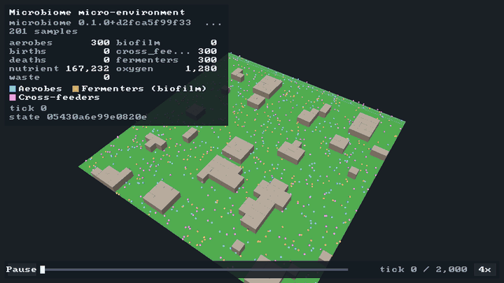
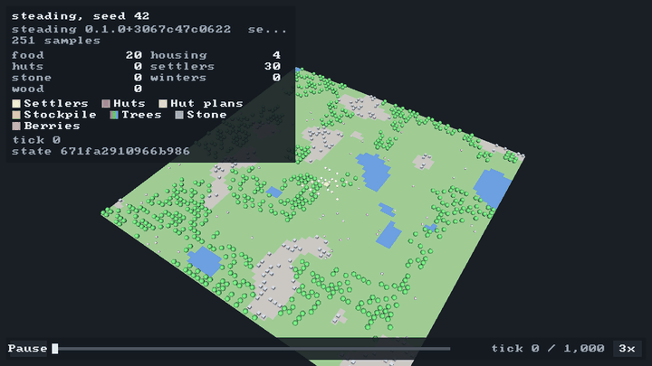
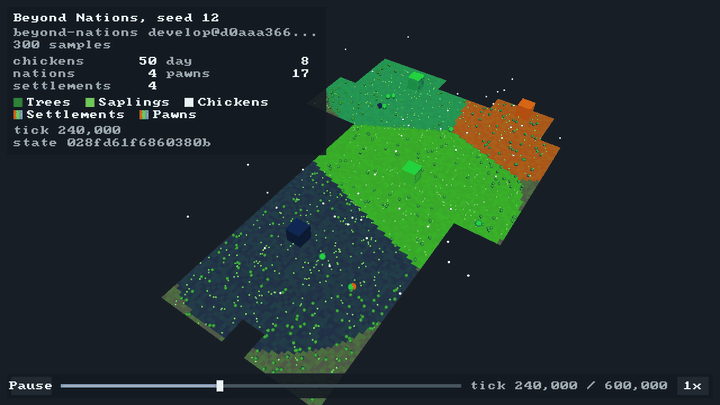
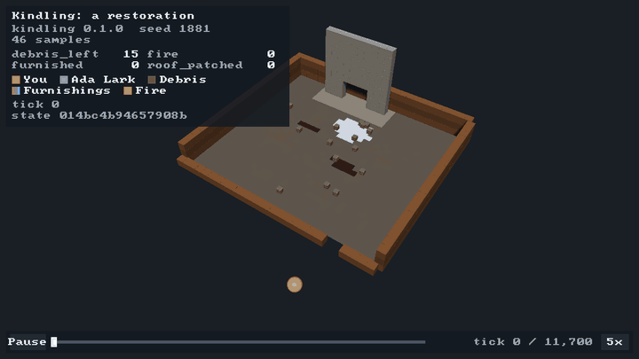
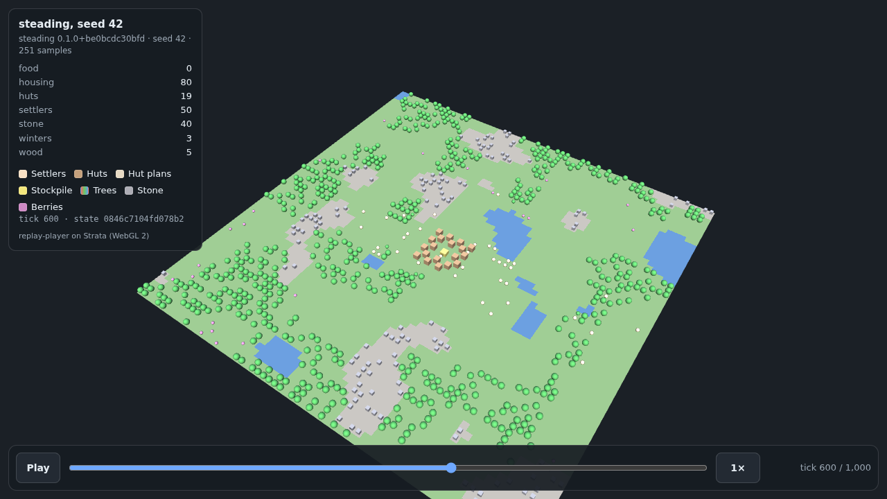
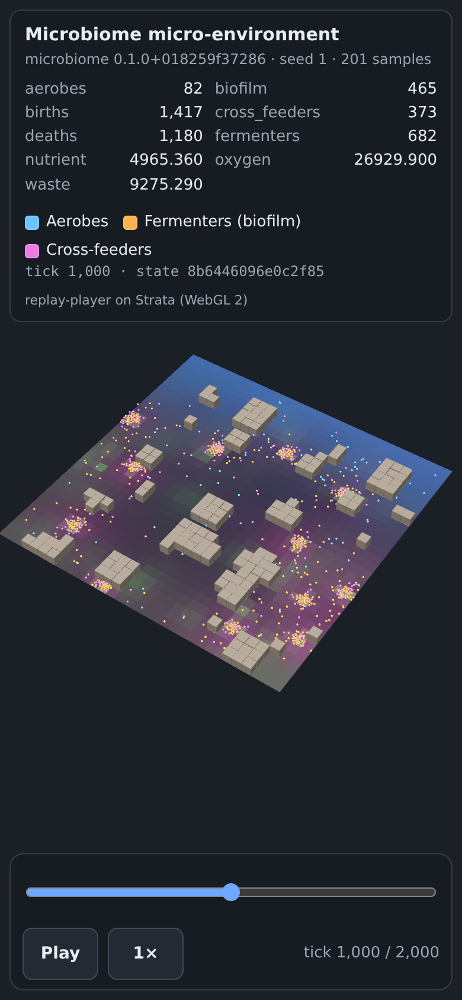

# replay-player

One player for every [`usd-replay/1`](https://github.com/Preponderous-Software/usd-recorder/blob/main/docs/REPLAY.md)
simulation replay, built on the [Strata](https://github.com/Preponderous-Software/strata) engine. It runs on the desktop
(Linux and Windows) and in the browser (WebGL 2). It plays any file that passes `usd-recorder replay validate` and needs
no code for any particular simulation: the entity sets, colour fields, stats, legend and state hash all come from the
replay. **Try it in a browser:** <https://replay-player.play.danielstephenson.dev> (steading, microbiome, Beyond
Nations and Kindling replays, behind a picker).

| microbiome (`mb_strata --record`) | steading (`steading-replay`) |
|---|---|
|  |  |
| **Beyond Nations** (`tools/history-to-replay.py`) | **Kindling** (the restoration replay) |
|  |  |

Every frame above is the desktop player drawing headless (`--frames`, software GL), with its own HUD: the panel shows
the run, the stats held at the current tick, a legend in each set's colour and the **state hash** of the tick on
screen; the bar has play/pause, a scrubber, the tick and the speed. The microbiome, steading and Kindling replays were
opened as `.usda` files, Beyond Nations as a usd-web bundle. [docs/media/SOURCES.md](docs/media/SOURCES.md) lists the
commit and command behind each one.

## Two inputs, one player

| Input | Where | How it is read |
|---|---|---|
| a `.usda` or `.usdc` replay | desktop, with `-DREPLAY_PLAYER_WITH_USD=ON` | usd-recorder's C++ reader (`usd_recorder::read_replay`, which links OpenUSD v26.08) |
| a [usd-web](https://github.com/Preponderous-Software/usd-web) bundle (`replay.json` + gzip'd UWR1 chunks) | desktop and browser | this repository's C++ decoder (`src/model/bundle.cpp`) |

Both become the same in-memory `ReplayModel`, played by the same `Playback` and drawn by the same `StrataScene`.
Playback follows usd-web's player: `playbackRate x speed` ticks per second (0.25x to 8x), positions interpolated for
ids present in both neighbouring samples, fields and stats held between their samples, Z-up replay coordinates drawn as
`(x, z, -y)`. A bundle is the `.usdc` quantized for the web; CI checks that the two models agree to within half a
quantization step and draw the same golden images.

The browser page reads bundles only: OpenUSD is not built for WebAssembly, and the bundle is what producers and sites
already publish.





## Desktop

```sh
cmake -S . -B build && cmake --build build -j8        # fetches Strata v0.5.0 (and SDL3)
./build/replay-player path/to/bundle/                  # a usd-web bundle directory (or its replay.json)
```

With `.usda` / `.usdc` support (OpenUSD v26.08 found as a CMake package; Strata publishes a prebuilt install for
Ubuntu 24.04 / GCC 13 and Windows / MSVC as release assets):

```sh
cmake -S . -B build -DREPLAY_PLAYER_WITH_USD=ON -DCMAKE_PREFIX_PATH=/path/to/openusd && cmake --build build -j8
./build/replay-player run.usdc
```

Keys: **Space** play/pause, **Left/Right** step a sample, **+/-** speed, **Home/End** first/last sample, **I**
interpolation, **L** loop, **H** hide the HUD, **R** reset the view, **F12** screenshot, **Esc** quit. Drag to orbit,
right-drag (or Shift+drag) to pan, wheel to zoom, click or drag the scrubber to seek.

Headless (Linux, EGL surfaceless; software GL works):

```sh
replay-player run.usdc --headless --at 600 --screenshot shot.png
replay-player run.usdc --frames frames/ --count 72 --fps 12 --speed 3 --spin 8   # then tools/make_gif.py
replay-player run.usdc --info                                                    # a JSON summary, no GPU
```

Other options: `--width/--height`, `--speed`, `--paused`, `--no-hud`, `--no-shadows`, `--no-interpolate`,
`--theta/--phi` (camera angles) and `--zoom`. `replay-player --help` lists them all.

## Browser

```sh
emcmake cmake -S . -B build-web -DREPLAY_PLAYER_WEB=ON -DREPLAY_PLAYER_WITH_STRATA=OFF && cmake --build build-web
tools/assemble_site.sh build-web site && python3 -m http.server -d site
# open http://localhost:8000/ (the picker's replays), or copy a bundle into site/ and open ?data=its-dir/
```

Every push to `main` deploys the site to <https://replay-player.play.danielstephenson.dev> (arcade, through
`browser.yml`). The page offers the replays listed in `web/replays/index.json` in a picker and opens the first;
[web/replays/SOURCES.md](web/replays/SOURCES.md) says where each came from.

Emscripten 6.0.11 (Strata's pin). The page takes `?data=<relative bundle dir>/`, `speed`, `autoplay=0`, `at=<tick>`,
`interpolate=0` and `shadows=0|1` (shadows are off by default on touch screens). Its layout, controls and test hook
(`window.__usdWebReplay`) are usd-web's `viewer/replay.html`, so one page can stand in for the other. The `.wasm` is
1.04 MB, **338 KB gzip'd** (the budget is 600 KB), and needs no COOP/COEP headers.

## Tests

| Check | Where |
|---|---|
| Decoder, gunzip, JSON and playback unit tests (also as wasm under Node) | `tests/test_*.cpp`, `ctest` |
| The C++ UWR1 decoder against usd-web's Python decoder, chunk by chunk | `tests/cross_decode.py` |
| A `.usdc` read natively and its bundle give the same model (up to quantization) | `tools/replay_compare.cpp` |
| Golden images drawn headless and compared with Strata's `strata-imgcmp`, from bundles and from `.usdc` | `tests/golden/` |
| Browser smoke test in headless Chromium, desktop and phone (usd-web's replay smoke checks), and the size budget | `web/smoke/`, `.github/workflows/browser.yml` |

The test corpus (`tests/corpus/`) is a short steading run and Kindling's restoration, each as `.usdc` and as a bundle.

## Design

[ARCHITECTURE.md](ARCHITECTURE.md) covers the code, the colour and coordinate rules, the browser surface and the
decisions taken. In short: RFC 0025 proposed one player for the replay contract, built on Strata; the C++ reader lives in
usd-recorder next to the writers, the decoder and player live here, and the browser player sits beside usd-web's
three.js player rather than replacing it.

## Licence

MIT, see [LICENSE](LICENSE). The images in `docs/media` show replays of the projects named above, each under its own
licence.
